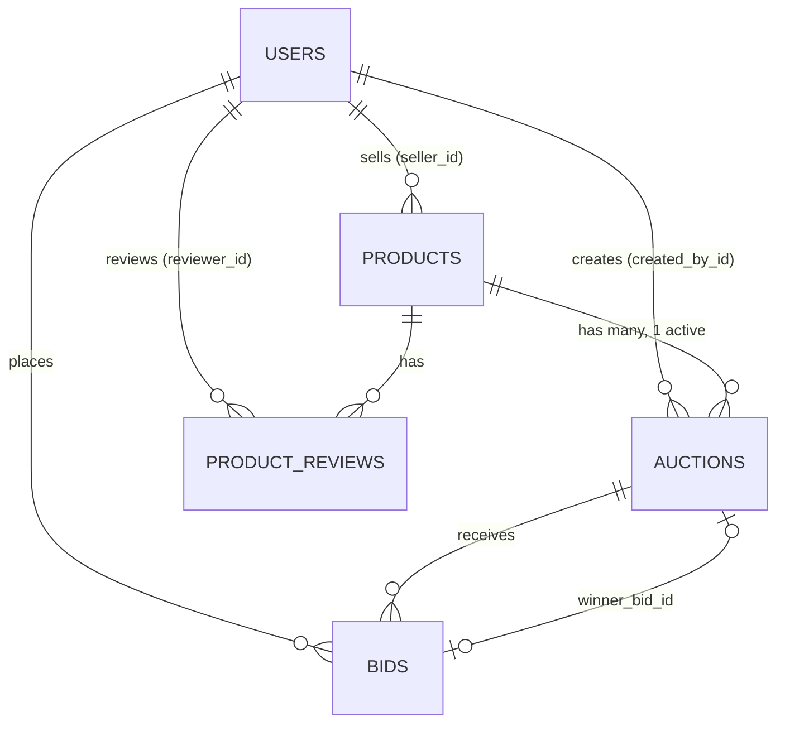
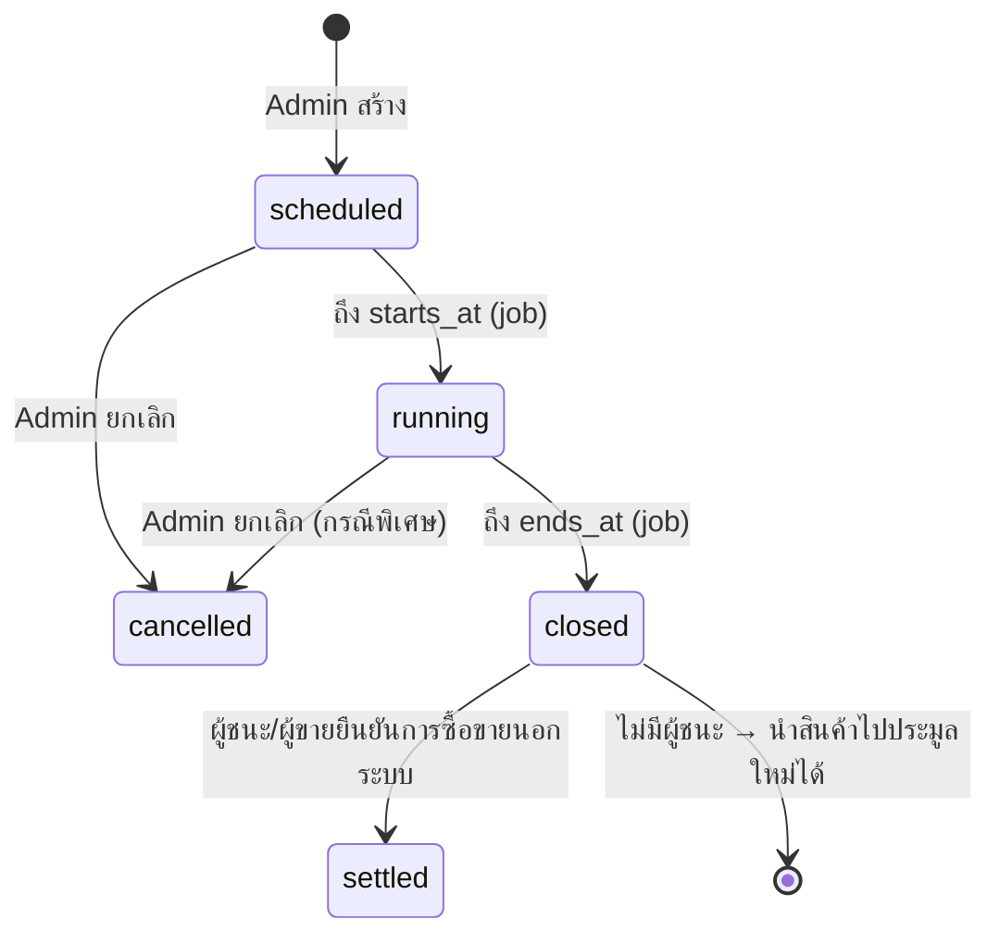

# การออกแบบการประมูล (Auction Design)

> สถานะ: ตกลงใน Sprint 0 — แก้ไขผ่าน PR เมื่อ design เปลี่ยน

## 1. หลักการ: แยก Product กับ Auction

- **Product** = สินค้าที่ผู้ขายลง ผ่านการตรวจสอบโดย Admin (draft → pending_review → approved / rejected)
- **Auction** = รอบการประมูลของสินค้า 1 ชิ้น
- สินค้า 1 ชิ้นมีได้ **หลาย auction** (เช่น รอบแรกไม่มีผู้เสนอ แล้วนำไปประมูลใหม่) แต่ **active ได้ครั้งละ 1** (`scheduled` หรือ `running`)
- **ใครกำหนดอะไร**
  - ผู้ขาย: ราคาเริ่มต้น (`products.starting_price`) และระยะเวลาที่ต้องการ (`products.desired_duration`, 1 ชั่วโมง – 7 วัน — เป็นค่าเสนอ)
  - Admin: วิธีประมูล (`auction_type`) และเวลาเริ่ม/สิ้นสุดจริง (`starts_at`, `ends_at`)



## 2. Schema

### `auctions`

| Column | Type | หมายเหตุ |
|---|---|---|
| `product_id` | bigint FK, not null | |
| `auction_type` | integer enum, not null | `fpsba: 0` — อนาคต `english`, `vickrey`, `dutch` |
| `starting_price` | integer, not null | **คัดลอก** จากสินค้าตอนสร้าง (snapshot — สินค้าเปลี่ยนภายหลังไม่กระทบ) |
| `starts_at`, `ends_at` | datetime, not null | check constraint `ends_at > starts_at` |
| `status` | integer enum, not null | ดู state machine ด้านล่าง |
| `settings` | jsonb, default `{}` | ค่าเฉพาะวิธี (เช่น English: `min_increment`; Dutch: `decrement`, `floor_price`) |
| `winner_bid_id` | bigint FK → bids, nullable | กำหนดตอนปิด |
| `created_by_id` | bigint FK → users, not null | Admin ที่สร้าง |

Index / constraint:
- **1 active auction ต่อสินค้า**: partial unique index
  `CREATE UNIQUE INDEX ... ON auctions (product_id) WHERE status IN (scheduled, running)`
- index `(status, ends_at)` สำหรับ job ปิดประมูล

### `bids`

| Column | Type | หมายเหตุ |
|---|---|---|
| `auction_id` | bigint FK, not null | |
| `user_id` | bigint FK, not null | |
| `amount` | integer, not null | หน่วยบาท, check `amount > 0` |
| `created_at` | datetime, not null | ใช้ตัดสินกรณีราคาเท่ากัน |

- FPSBA: **unique index `(auction_id, user_id)`** — กติกา "เสนอได้ครั้งเดียว" บังคับที่ DB
- Bid เป็น **immutable** — ไม่มี update/destroy ใน FPSBA (ไม่มี `updated_at` logic)
- วิธีอื่น (English/Dutch) ที่เสนอได้หลายครั้ง: unique index นี้ต้องเปลี่ยนเป็นตรวจใน strategy — ตัดสินใจตอนทำ M6

## 3. State machine ของ Auction



- เปลี่ยน state ผ่าน service object เท่านั้น ใช้ transaction + conditional update (ดู `Product#transition!`) — **หมายเหตุ:** ตั้งแต่ย้ายมา SQLite `lock!` ไม่มีผล (SQLite ไม่มี `SELECT ... FOR UPDATE`) จุดที่เขียนว่า lock ด้านล่างให้ใช้วิธีเดียวกัน
- `starts_at` / `ends_at` เป็นเวลาจริงที่ Admin กำหนด (default เสนอจาก `desired_duration` ของสินค้า)

## 4. กติกา FPSBA (First-Price Sealed-Bid Auction)

| # | กติกา | บังคับที่ |
|---|---|---|
| 1 | เสนอได้ **ครั้งเดียวต่อคน** และ **แก้ไขไม่ได้** | unique index `(auction_id, user_id)` + ไม่มี update route |
| 2 | `amount ≥ starting_price` | `Strategies::Fpsba#validate_bid!` |
| 3 | **ผู้ขายเสนอราคาสินค้าตัวเองไม่ได้** | `Strategies::Base#validate_bid!` (ใช้กับทุกวิธี) |
| 4 | เสนอได้เฉพาะตอน `running` และ `now < ends_at` | `Bids::Place` (lock auction row) |
| 5 | **ซ่อนราคาทุกคน** จนปิดประมูล (รวมจำนวนเงินของคนอื่น — ผู้เสนอเห็นแค่ของตัวเอง) | `bids_visible?` → false จนกว่า `closed` |
| 6 | ปิดด้วย **background job** (Solid Queue) เมื่อถึง `ends_at` | `Auctions::CloseJob` enqueue `wait_until: ends_at` + recurring sweep ทุก 1 นาทีกันพลาด |
| 7 | **ราคาสูงสุดชนะ** | `determine_winner` |
| 8 | **ราคาเท่ากัน ผู้เสนอก่อนชนะ** | `ORDER BY amount DESC, created_at ASC, id ASC` |
| 9 | **ไม่มีผู้เสนอ** = `closed` ไม่มีผู้ชนะ และนำสินค้าไปประมูลใหม่ได้ | `winner_bid_id = nil`; partial index อนุญาต auction ใหม่ |
| 10 | ผู้ชนะจ่าย **ราคาที่ตัวเองเสนอ** | `price_to_pay` = winning bid amount |

## 5. Strategy pattern

```ruby
# app/services/auctions/strategies/base.rb
module Auctions
  module Strategies
    class Base
      def initialize(auction) = @auction = auction

      # raise Bids::Invalid ถ้าเสนอไม่ได้ — subclass เรียก super ก่อนเพิ่มกติกาของตัวเอง
      def validate_bid!(user:, amount:)
        raise Bids::Invalid, "ผู้ขายเสนอราคาสินค้าตัวเองไม่ได้" if user.id == @auction.product.seller_id
        raise Bids::Invalid, "การประมูลไม่เปิดรับราคา" unless @auction.running? && Time.current < @auction.ends_at
      end

      def determine_winner = raise(NotImplementedError) # => Bid หรือ nil
      def bids_visible?(viewer:) = raise(NotImplementedError)
      def price_to_pay = raise(NotImplementedError)       # => Integer หรือ nil
    end

    class Fpsba < Base
      def validate_bid!(user:, amount:)
        super
        raise Bids::Invalid, "ราคาต้องไม่ต่ำกว่า #{@auction.starting_price}" if amount < @auction.starting_price
      end

      def determine_winner = @auction.bids.order(amount: :desc, created_at: :asc, id: :asc).first
      def bids_visible?(viewer:) = @auction.closed? || @auction.settled?
      def price_to_pay = @auction.winner_bid&.amount
    end
  end
end

# app/models/auction.rb
def strategy = "Auctions::Strategies::#{auction_type.camelize}".constantize.new(self)
```

**เพิ่มวิธีประมูลใหม่ = enum 1 ค่า + class 1 ไฟล์** (+ test ของ strategy นั้น)

| วิธี (M6) | `validate_bid!` | `determine_winner` | `bids_visible?` | `price_to_pay` |
|---|---|---|---|---|
| English | > ราคาสูงสุดปัจจุบัน + `settings.min_increment` | สูงสุด | true (เปิดเผย) | ราคาที่ชนะ |
| Vickrey | เหมือน FPSBA | สูงสุด (เท่ากัน = ก่อน) | false จนปิด | **ราคาสูงอันดับ 2** (หรือ starting_price ถ้ามีคนเดียว) |
| Dutch | ราคาปัจจุบันลดตามเวลา, คนแรกที่รับชนะทันที | bid แรก | true | ราคา ณ ตอนรับ |

## 6. Flow หลัก

1. ผู้ขายสร้างสินค้า (draft) → ส่งตรวจ (pending_review)
2. Admin approve (หรือ reject พร้อมเหตุผล → ผู้ขายแก้แล้วส่งใหม่)
3. Admin สร้าง auction จากสินค้า approved: เลือก `auction_type`, `starts_at`, `ends_at` → `scheduled`
4. Job เปลี่ยนเป็น `running` เมื่อถึง `starts_at`
5. ผู้ใช้เสนอราคาผ่าน `Bids::Place` → `auction.strategy.validate_bid!`
6. Job ปิดเมื่อถึง `ends_at` → `Auctions::Close`: lock → `determine_winner` → บันทึก `winner_bid_id` → `closed` → ส่งอีเมลแจ้งผล (M3)
7. **MVP: การชำระเงินและส่งของทำนอกระบบ** — หลังปิด ระบบแสดงข้อมูลติดต่อของผู้ชนะให้ผู้ขาย และของผู้ขายให้ผู้ชนะ (เห็นเฉพาะ 2 ฝ่ายนี้) → Admin กด `settled` เมื่อซื้อขายเสร็จ

## 7. ความเสี่ยงที่ต้องระวัง

- **Race condition** ตอนเสนอราคาใกล้ `ends_at` และตอนปิด: ใช้ `auction.lock!` ทั้งใน `Bids::Place` และ `Auctions::Close`, ตรวจเวลาด้วยเวลา DB/server เดียวกัน
- **Job พลาด** (server restart): recurring sweep ใน `config/recurring.yml` ปิด auction ที่ `running` และ `ends_at < now`
- **การรั่วของราคา**: ห้าม render amount ของคนอื่นใน view/JSON/log ก่อนปิด — มี request spec ตรวจ
- **Time zone**: เก็บ UTC, แสดง `Asia/Bangkok`
